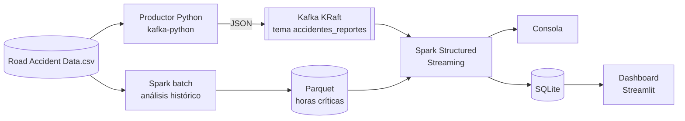

# Análisis de accidentes de tránsito en tiempo real con Apache Kafka y Spark Structured Streaming

Proyecto del curso **Big Data (código 202016911)** · Universidad Nacional Abierta y a Distancia (UNAD) · Programa de Ingeniería de Sistemas.

Este proyecto procesa el histórico de accidentes de tránsito con Apache Spark y simula la llegada de nuevos reportes mediante Apache Kafka, para detectar horarios críticos, zonas con alta incidencia y condiciones asociadas con lesiones.

## Tabla de contenido

1. [Definición del problema](#1-definición-del-problema)
2. [Conjunto de datos](#2-conjunto-de-datos)
3. [Arquitectura](#3-arquitectura)
4. [Tecnologías y versiones](#4-tecnologías-y-versiones)
5. [Estructura del repositorio](#5-estructura-del-repositorio)
6. [Instalación](#6-instalación)
7. [Ejecución paso a paso](#7-ejecución-paso-a-paso)
8. [Descripción de los scripts](#8-descripción-de-los-scripts)
9. [Formato del mensaje en Kafka](#9-formato-del-mensaje-en-kafka)
10. [Consultas de streaming](#10-consultas-de-streaming)
11. [Dashboard en tiempo real](#11-dashboard-en-tiempo-real)
12. [Capturas de pantalla](#12-capturas-de-pantalla)
13. [Solución de problemas](#13-solución-de-problemas)
14. [Limitaciones y trabajo futuro](#14-limitaciones-y-trabajo-futuro)
15. [Fuente de los datos y créditos](#15-fuente-de-los-datos-y-créditos)

## 1. Definición del problema

Los accidentes de tránsito generan grandes cantidades de información que pueden analizarse para identificar horarios críticos, ubicaciones con alta incidencia y condiciones asociadas con lesiones.

El proyecto responde a dos necesidades:

- **Análisis histórico (batch):** procesar con Spark el conjunto completo de registros para establecer una línea base.
- **Detección en tiempo real (streaming):** simular la recepción de nuevos reportes y compararlos con esa línea base para detectar patrones a medida que llegan.

## 2. Conjunto de datos

Archivo: `Road Accident Data.csv`, con registros de accidentes de tráfico en Kensington y Chelsea (enero de 2021). Incluye la fecha del accidente, el día de la semana, el control de la intersección, la gravedad, las coordenadas geográficas, las condiciones de iluminación y meteorológicas, los detalles del vehículo y más.

El archivo **no se incluye en el repositorio**. Consulte [`data/README.md`](data/README.md) para colocarlo en su sitio.

### Variables utilizadas

| Variable del proyecto | Columna esperada en el CSV | Nombre interno |
|---|---|---|
| Fecha del accidente | `Accident Date` | `fecha` |
| Hora | `Time` | `hora` |
| Latitud | `Latitude` | `latitud` |
| Longitud | `Longitude` | `longitud` |
| Número de víctimas | `Number_of_Casualties` | `num_victimas` |
| Número de vehículos | `Number_of_Vehicles` | `num_vehiculos` |
| Tipo de vehículo | `Vehicle_Type` | `tipo_vehiculo` |
| Condiciones meteorológicas | `Weather_Conditions` | `clima` |

Si el encabezado de su archivo difiere, edite el diccionario `MAPA` en `spark_batch_historico.py` y `COLUMNAS` en `kafka_producer_accidentes.py`.

### Campos derivados

- `hora_dia`: hora del accidente (0 a 23), tomada de la parte anterior a los dos puntos en `Time`.
- `zona`: latitud y longitud redondeadas a 2 decimales, lo que equivale a una cuadrícula de aproximadamente 1 km.
- `event_time`: momento en que el productor envía el reporte. Se usa para las ventanas de tiempo.

## 3. Arquitectura



**Flujo de datos**

1. Spark procesa el CSV completo y guarda en Parquet las horas con más accidentes (horas críticas).
2. El productor lee el CSV, mezcla los registros y los envía uno a uno a Kafka como reportes nuevos.
3. Spark Structured Streaming consume el tema, agrega por ventana, hora, zona y clima, y cruza el resultado con las horas críticas del histórico.
4. Los resultados se muestran en consola y, opcionalmente, se guardan en SQLite para el dashboard.

## 4. Tecnologías y versiones

| Componente | Versión |
|---|---|
| Sistema operativo | Ubuntu 22.04 LTS (máquina virtual en VirtualBox) |
| Java | 11 |
| Apache Spark | 3.5.3 (Scala 2.12) |
| Apache Kafka | 3.9.1 (modo KRaft, sin ZooKeeper) |
| Python | 3.10 |
| kafka-python | última versión disponible en PyPI |
| Streamlit y pandas | Solo para el dashboard (opcional) |

El conector de Spark para Kafka debe coincidir con la versión de Spark y de Scala: `org.apache.spark:spark-sql-kafka-0-10_2.12:3.5.3`.

## 5. Estructura del repositorio

```
accidentes-transito-kafka-spark/
├── README.md
├── requirements.txt
├── .gitignore
├── src/
│   ├── spark_batch_historico.py
│   ├── kafka_producer_accidentes.py
│   ├── spark_streaming_accidentes.py
│   ├── spark_streaming_dashboard.py
│   └── dashboard.py
├── data/
│   └── README.md
└── docs/
```

## 6. Instalación

### 6.1 Clonar el repositorio

```bash
git clone https://github.com/SU-USUARIO/accidentes-transito-kafka-spark.git
cd accidentes-transito-kafka-spark
```

### 6.2 Dependencias de Python

```bash
pip install -r requirements.txt
```

### 6.3 Datos

Descargue el CSV desde su fuente original y guárdelo como:

```
/home/vboxuser/data/Road_Accident_Data.csv
```

Si usa otra ruta, cambie la variable `RUTA` en `spark_batch_historico.py` y el argumento `--archivo` del productor. Verifique el encabezado con:

```bash
head -3 /home/vboxuser/data/Road_Accident_Data.csv
```

### 6.4 Apache Kafka (modo KRaft)

```bash
cd ~
wget https://archive.apache.org/dist/kafka/3.9.1/kafka_2.13-3.9.1.tgz
tar -xzf kafka_2.13-3.9.1.tgz
sudo mv kafka_2.13-3.9.1 /opt/kafka
sudo chown -R vboxuser:vboxuser /opt/kafka
```

Configure el directorio de datos y formatee el almacenamiento (se hace **una sola vez**):

```bash
cd /opt/kafka
sed -i 's|^log.dirs=.*|log.dirs=/home/vboxuser/kafka-logs|' config/kraft/server.properties
KAFKA_CLUSTER_ID=$(bin/kafka-storage.sh random-uuid)
bin/kafka-storage.sh format -t $KAFKA_CLUSTER_ID -c config/kraft/server.properties
```

No ejecute Kafka con `sudo`: crearía archivos con dueño `root` y provocaría errores de permisos.

## 7. Ejecución paso a paso

Cree las carpetas de trabajo una sola vez:

```bash
mkdir -p ~/data ~/resultados
```

### Paso 1. Iniciar Kafka y crear el tema

```bash
/opt/kafka/bin/kafka-server-start.sh -daemon /opt/kafka/config/kraft/server.properties
sleep 10
/opt/kafka/bin/kafka-topics.sh --create --bootstrap-server localhost:9092 \
  --replication-factor 1 --partitions 1 --topic accidentes_reportes
```

El tema se crea solo la primera vez. Para comprobar que Kafka responde:

```bash
/opt/kafka/bin/kafka-topics.sh --bootstrap-server localhost:9092 --list
```

### Paso 2. Análisis histórico (batch)

```bash
spark-submit src/spark_batch_historico.py
```

Genera `~/resultados/hist_hora` (Parquet) con las horas críticas, que el consumidor usa después.

### Paso 3. Productor (terminal 1)

```bash
python3 src/kafka_producer_accidentes.py --delay 0.5
```

| Argumento | Valor por defecto | Descripción |
|---|---|---|
| `--archivo` | `/home/vboxuser/data/Road_Accident_Data.csv` | Ruta del CSV |
| `--servidor` | `localhost:9092` | Dirección del broker |
| `--topico` | `accidentes_reportes` | Tema de destino |
| `--delay` | `0.5` | Segundos entre reportes |

### Paso 4. Consumidor con Spark Streaming (terminal 2)

```bash
spark-submit --packages org.apache.spark:spark-sql-kafka-0-10_2.12:3.5.3 \
  src/spark_streaming_accidentes.py todas
```

El último argumento selecciona la consulta a ejecutar: `ventana`, `horario`, `zonas`, `alertas` o `todas`. Si la máquina virtual va lenta, ejecute una sola.

### Paso 5. Detener todo

Pulse `Ctrl+C` en cada terminal (primero el consumidor y luego el productor) y detenga Kafka:

```bash
/opt/kafka/bin/kafka-server-stop.sh
```

**Orden recomendado:** Kafka activo, tema creado, análisis histórico, productor y consumidor.

## 8. Descripción de los scripts

| Script | Función |
|---|---|
| `spark_batch_historico.py` | Lee el CSV completo, valida las columnas y calcula accidentes y víctimas por hora, zonas, condiciones meteorológicas y tipo de vehículo. Guarda las 5 horas con más accidentes como horas críticas. |
| `kafka_producer_accidentes.py` | Lee el CSV, mezcla los registros, los convierte a JSON y los envía al tema de Kafka. Asigna `event_time` en el momento del envío. |
| `spark_streaming_accidentes.py` | Consume el tema, interpreta el JSON, deriva `hora_dia` y `zona`, ejecuta las consultas de streaming y muestra los resultados en consola. |
| `spark_streaming_dashboard.py` | Variante del consumidor que escribe los resultados de cada lote en SQLite. |
| `dashboard.py` | Aplicación Streamlit que lee SQLite y se refresca automáticamente. |

## 9. Formato del mensaje en Kafka

Cada reporte es un JSON con esta estructura (los valores son un ejemplo):

```json
{
  "fecha": "1/1/2021",
  "hora": "17:50",
  "latitud": 51.5,
  "longitud": -0.19,
  "num_victimas": 1,
  "num_vehiculos": 2,
  "tipo_vehiculo": "Car",
  "clima": "Fine no high winds",
  "event_time": 1760000000
}
```

`event_time` son los segundos desde 1970 (hora Unix) del momento del envío. Spark lo convierte a `timestamp` para las ventanas de tiempo.

Puede verificar el flujo sin Spark con:

```bash
/opt/kafka/bin/kafka-console-consumer.sh --bootstrap-server localhost:9092 \
  --topic accidentes_reportes --from-beginning --max-messages 5
```

## 10. Consultas de streaming

| Consulta | Qué calcula | Modo de salida |
|---|---|---|
| `ventana` | Accidentes, víctimas y promedio de vehículos por minuto y condición meteorológica, con *watermark* de 2 minutos | update |
| `horario` | Accidentes en vivo por hora del día, indicando si esa hora es crítica según el histórico (unión stream-estática con el Parquet) | complete |
| `zonas` | Las 10 zonas con más accidentes | complete |
| `alertas` | Reportes graves: 3 o más víctimas o 4 o más vehículos | append |

Todas se ejecutan con un intervalo de 10 segundos y 4 particiones de *shuffle*, un valor adecuado para el tamaño del conjunto de datos.

## 11. Dashboard en tiempo real

El dashboard muestra métricas generales, accidentes por hora, ritmo de llegada por minuto, mapa y tabla de zonas, condiciones meteorológicas y últimas alertas graves.

Se necesitan tres terminales:

```bash
# Terminal 1: productor
python3 src/kafka_producer_accidentes.py --delay 0.5

# Terminal 2: Spark guarda los resultados en SQLite
spark-submit --packages org.apache.spark:spark-sql-kafka-0-10_2.12:3.5.3 \
  src/spark_streaming_dashboard.py

# Terminal 3: dashboard
python3 -m streamlit run src/dashboard.py \
  --server.address 0.0.0.0 --server.port 8501 --server.headless true
```

Abra `http://IP-DE-LA-VM:8501` en el navegador. La IP se obtiene con `hostname -I` y puede cambiar entre sesiones. Si modifica las consultas, borre antes la base con `rm ~/resultados/dashboard.db` para evitar tablas con columnas antiguas.

La consola web de Spark está disponible en `http://IP-DE-LA-VM:4040` mientras corre el consumidor.

## 12. Capturas de pantalla

Agregue sus capturas a la carpeta `docs/` con estos nombres, o ajuste las rutas.

| Descripción | Archivo |
|---|---|
| Kafka activo y tema creado | `docs/01_kafka_tema.png` |
| Productor enviando reportes | `docs/02_productor.png` |
| Consumidor con Spark Streaming | `docs/03_consumidor.png` |
| Dashboard en tiempo real | `docs/04_dashboard.png` |
| Consola web de Spark (puerto 4040) | `docs/05_spark_ui.png` |

```markdown

```

## 13. Solución de problemas

| Síntoma | Causa probable | Solución |
|---|---|---|
| `Columnas no encontradas` | El encabezado del CSV difiere de lo esperado | Editar `MAPA` y `COLUMNAS` según `head -3` |
| `NoBrokersAvailable` | Kafka no está activo | Repetir el inicio de Kafka y revisar `/opt/kafka/logs/server.log` |
| `server.log: Permission denied` | Las carpetas de Kafka pertenecen a `root` | `sudo chown -R vboxuser:vboxuser /opt/kafka /home/vboxuser/kafka-logs` |
| `Failed to find data source: kafka` | Falta `--packages` o la versión no coincide | Usar el comando completo con la versión correcta de Spark y Scala |
| El consumidor no muestra datos | El productor no está enviando | Iniciar el productor y comprobar con `kafka-console-consumer.sh` |
| `Path does not exist: .../hist_hora` | No se ejecutó el análisis histórico | Ejecutar `spark_batch_historico.py` |
| `hora_dia` o `latitud` en `null` | `Time` no tiene formato `HH:MM` o faltan coordenadas | Revisar el formato del CSV y ajustar la extracción de la hora |
| Poca memoria o lentitud | La máquina virtual tiene poca RAM | Aumentar la RAM o ejecutar una sola consulta |
| Disco lleno | Poco espacio libre en la VM | Borrar el `.tgz` de Kafka y archivos temporales; revisar con `df -h` |

## 14. Limitaciones y trabajo futuro

- **Simulación:** los reportes provienen del mismo CSV, mezclados al azar. No hay un sistema real de reporte de accidentes.
- **Un solo broker y una partición:** adecuado para una máquina virtual, pero no refleja un clúster real.
- **Zonas por redondeo de coordenadas:** es una aproximación simple; podría reemplazarse por geohash o agrupación espacial.
- **Rutas fijas:** los scripts usan rutas como `/home/vboxuser/...` y requieren ajuste en otros entornos.
- **Mejoras posibles:** persistir resultados en una base de datos como PostgreSQL con Grafana, añadir un modelo de predicción de gravedad y usar varias particiones con más consumidores.

## 15. Fuente de los datos y créditos

- **Datos:** *Road Accident Data* (registros de accidentes de tráfico en Kensington y Chelsea, enero de 2021). Indique aquí el enlace a la fuente original y su licencia.
- **Software:** Apache Kafka, Apache Spark, Streamlit y kafka-python, cada uno bajo su propia licencia.

**Autor:** Su nombre · Ingeniería de Sistemas · UNAD
